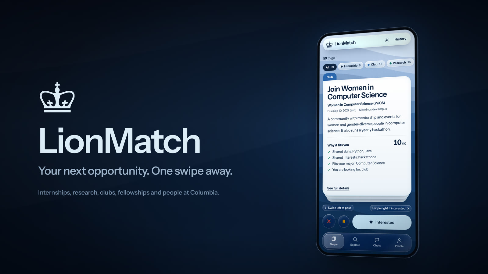

# LionMatch

**Try it live: [lionmatch.vercel.app](https://lionmatch.vercel.app)**

Swipe through internships, clubs, research and fellowships at Columbia. Every card shows a match score out of 10 and the reasons behind it, and the deck learns from what you swipe. When something fits, you can read the details, find someone to talk to, and send a coffee chat in a few taps.

## Demo

[](https://github.com/4amGrind/columbia-tinder/raw/main/docs/lionmatch-demo.mp4)

**[Download the 86-second demo](https://github.com/4amGrind/columbia-tinder/raw/main/docs/lionmatch-demo.mp4)** (MP4, 22 MB, with sound)

## Run it

You need Node 22.13 or newer.

```bash
git clone https://github.com/4amGrind/columbia-tinder.git
cd columbia-tinder
npm install
npm run dev
```

Then open http://localhost:3000. No accounts or keys are needed.

## What you can do

- **Swipe.** Drag a card right for Interested, left to Pass, or up to Save. The buttons and arrow keys do the same, and Undo brings the last card back. A strong match (8 or more) gets confetti.
- **Filter the deck.** Chips above the deck switch between internships, clubs, research, fellowships and people.
- **See why it fits.** Every card lists the reasons behind its score, such as shared skills, shared interests, your major and what you are looking for.
- **Explore.** Search everything by name, skill, topic or course. Sort by best match, deadline or name, hide closed listings, or show only the ones whose course prerequisites you meet.
- **Read the details.** Each listing shows location, time commitment, deadline, majors, helpful skills, prerequisites, a link to the official page, and sometimes someone to talk to.
- **Meet people.** People profiles show why you would get along. Reach out with a coffee chat or outreach message, drafted for you and fully editable, and it lands in Chats.
- **Watch it learn.** History shows everything you have swiped and what the deck has learned from it. Sample tastes let you see the learning with no swiping.
- **Tell it about you.** Set your skills, interests, major and what you are looking for in Preferences, or import them from a PDF resume or LinkedIn export.
- **Light or dark.** The sun and moon button switches themes.

## How the match score works

Every listing is scored out of 10:

- Everyone starts at 3, so no card looks hopeless.
- Shared skills add 1.5 each, up to 3.
- Shared interests add 1 each, up to 2.
- A listing that names your major adds 1.5. One open to every major adds 0.5.
- A kind of listing you are looking for adds 1.

People are scored the same way, on shared skills, shared interests and the same major. Each of these shows up as a reason on the card, so the number never feels random.

## How the deck learns

1. Each card becomes a list of features, like `topic:robotics` or `skill:python`.
2. Interested and Save push those features up. Pass pushes them down, more gently. Old swipes fade, and a feature with little evidence stays near zero.
3. The deck order blends the match score with how much each card leans toward things you liked. With no swipes it is exactly the match score. After 15 swipes, your swipes decide 60 percent of the order. The match score always counts.
4. The cards on screen never jump. Only the cards behind them re-rank. Every fifth card is a wildcard from the part of the deck you have told it least about.
5. Cards say why, for example "Because you liked Columbia Space Initiative (robotics, hardware)".

## Resume import

The resume import reads a PDF in your browser. The file is never uploaded. It looks only for the skills and topics the listings use, and you choose which finds to add. It recognises common ways of writing the same thing, such as "Arduino" for Electronics or "PostgreSQL" for SQL, and never adds a skill the resume does not mention.

## About the data

- **Listings.** 48 listings. Clubs, labs and fellowships use real names from official Columbia pages, and each one links its source.
- **Checked listings.** 8 listings were checked in full against their official pages, including eligibility, prerequisites and deadlines. Deadlines that programs have not posted yet are shown as "estimated".
- **Prerequisites.** Course codes like `COMS W3134` are checked against the courses on your profile. Other rules, like class year or GPA, show as "check yourself".
- **Recruiting.** Being listed does not mean a club or lab is recruiting. The official page has the latest.
- **People.** The 12 people are made-up samples, labelled as such, so their chat replies are scripted.
- **Your data.** The demo runs as a sample student. Your swipes, chats and profile edits stay in your own browser.

## How it's built

- Next.js 16 and React 19, in TypeScript.
- Tailwind CSS 4, with a liquid-glass look over a Columbia-blue wave wallpaper.
- Motion for the swipe physics, and canvas-confetti for strong matches.
- pdf.js for reading resumes in the browser.
- A Supabase schema for a shared database. The live demo runs on the bundled data.
- The demo film is made in code with Remotion, from the real app's screens and algorithms ([`lionmatch-video/`](lionmatch-video/)).

| Where | What |
| --- | --- |
| `src/lib/match.ts` | The match score and its reasons |
| `src/lib/recommend.ts` | Learning from swipes and ordering the deck |
| `src/lib/resume.ts` | Resume import |
| `src/data/` | Listings and sample people |
| `src/app/` | One folder per screen |
