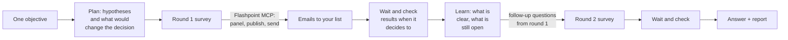

# Litmus: give it one question, it runs the research

Litmus is our entry for the Flashpoint MCP Challenge. You give an AI agent one high-level objective and a list of people who agreed to answer surveys. From there the agent works alone through the Flashpoint MCP:

1. It turns the objective into hypotheses and decides what to ask.
2. It writes a short survey, has Flashpoint publish it, and emails it to your list.
3. It decides when to check results, reads them, and writes down what it learned.
4. It writes a follow-up survey built from what round 1 showed, and sends that too.
5. It comes back with a direct answer, a confidence level, and a report with the real numbers.

No person picks a step after the objective. Every decision the agent makes is written to a transcript with its reason, so you can see round 2 come out of round 1.

It is for anyone with a decision and people to ask: student founders ("Should we build X?"), club boards ("Why did fewer first-years apply this year?"), or hackathon teams like ours. Our first objective is a real one: **what should LionMatch build next so that Columbia first-years actually use it every week?**

## How it works



Claude is the brain. It has seven tools, and it chooses which to call and when:

| Tool | What it does | Cost |
| --- | --- | --- |
| `note` | Records a decision and why. This is the log reviewers read. | free |
| `read_context` | Background on the product or group (for LionMatch: `context/lionmatch.md`). | free |
| `start_round` | Starts round 1 or the follow-up round, with its goal and what it builds on. | free |
| `create_panel_from_list` | Puts your email list into Flashpoint as a first-party panel. | $0.50 |
| `flashpoint_survey` | Talks to Flashpoint's survey agent (`tool_survey`) in plain language: draft, revise, publish, send, confirm, get results and breakdowns. | $0.50 |
| `wait` | Waits for people to answer, up to 20 minutes at a time. | free |
| `finish` | Writes the answer and the report. | free |

Each Flashpoint call goes through the Flashpoint MCP server at `api.flashpoint.ai/mcp`. Litmus signs in with a Base wallet and pays for each call in USDC over x402. The client is in `flashpoint.mjs`.

## Guardrails

The agent acts on its own, so the limits are in code, not in the prompt:

- **Names and emails never reach the AI.** `create_panel_from_list` reads `panel.csv` itself and sends it straight to Flashpoint. The agent only sees counts, like "12 people, 8 first-years". Every Flashpoint reply is scrubbed of emails and names before the agent, the terminal or any file sees it. If the agent tries to type an email address, the call is refused.
- **Hard budget.** A call that would go over `--budget` is refused.
- **Hard deadline.** `wait` will not wait past `--deadline`, and near the deadline the agent is forced to call `finish`.
- **Round cap.** At most `--rounds` rounds (default 2), and at most 100 people (Flashpoint's weekly invite limit).
- **One go-ahead.** Before a live run starts, you type `yes` once. Add `--ask-before-send` to also approve each send.
- **Only people who agreed.** The list should be people who said yes to short surveys. Never a scraped or bought list.
- **Resumable.** State is saved after every step. If your laptop sleeps, run `node run.mjs --resume <run id>`.

All of this is tested. `npm test` runs a full two-round run against a fake Flashpoint and checks the guardrails, with no keys and no network.

## Run it

You need Node 20 or newer.

```bash
cd agent
npm install
npm test                 # 9 tests, no keys needed
npm run mock -- --scripted   # practice run: fake Flashpoint, fixed steps, no keys
```

For a live run:

1. **Wallet.** `npm run wallet` makes a Base wallet and saves its key in `agent/.env`. Post the address it prints (never the key) to get Flashpoint credit. `npm run balance` shows your credit. Two rounds cost about $6.
2. **Claude.** Add `ANTHROPIC_API_KEY=sk-ant-...` to `agent/.env`.
3. **Email list.** Copy `panel.example.csv` to `panel.csv` and fill in people who agreed to answer. Columns: `name,email` plus anything useful like `year,school`. `panel.csv` is ignored by git.
4. **Practice with Claude** (free on Flashpoint, no emails): `npm run mock`
5. **Go:**

```bash
npm start -- "What should LionMatch build next so first-years use it every week?" --deadline 13:45
```

Leave out the objective to use the LionMatch one. Other options: `--budget 10`, `--rounds 2`, `--panel FILE`, `--context FILE`, `--model claude-opus-5-5`, `--ask-before-send`, `--resume RUN_ID`. Run `node run.mjs --help` for all of them.

Each run saves to `runs/<date-time>/`:

- `report.md`: the answer and full report
- `transcript.md`: every decision and its reason, every message to and from Flashpoint
- `flashpoint-replies.md`: every Flashpoint reply in full
- `state.json`: saved progress for `--resume` (ignored by git)

## Files

| File | What it is |
| --- | --- |
| `run.mjs` | The command line. Checks the wallet and Flashpoint, then starts the agent. |
| `lib/agent.mjs` | The agent loop and the tools, with every guardrail. |
| `lib/prompt.mjs` | The agent's instructions and tool definitions. |
| `lib/brain.mjs` | Claude as the brain, plus a scripted brain for tests. |
| `lib/panel.mjs` | Reads the email list, hides names and emails. |
| `lib/mock-flashpoint.mjs` | A fake Flashpoint survey agent for practice runs and tests. |
| `flashpoint.mjs` | The Flashpoint MCP client: wallet sign-in, MCP session, x402 payments. |
| `context/lionmatch.md` | Background on LionMatch for the first objective. |

## Team

Alex, Jun, Max, Peter and Ayan, Columbia first-years. LionMatch placed 3rd at the hackathon. Litmus is what we built next.
