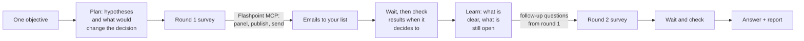

# Litmus

**Give an AI agent one question. It runs the survey research on its own and comes back with an answer.**

Litmus is our entry for the Flashpoint MCP Challenge. You give it one high-level objective and a list of people who agreed to answer surveys. From there the agent works alone through the Flashpoint MCP:

1. It turns the objective into hypotheses and decides what to ask.
2. It writes a short survey, has Flashpoint publish it, and emails it to your list.
3. It decides when to check results, reads them, and writes down what it learned.
4. It writes a follow-up survey built from what round 1 showed, and sends that too.
5. It comes back with a direct answer, a confidence level, and a report with the real numbers.

No person picks a step after the objective. Every decision is written to a transcript with its reason, so you can see round 2 come out of round 1.

Litmus is also an **MCP server**. Add it to Claude Desktop, Claude Code, Cursor or any MCP client, and your AI assistant can hand it a research question with one tool call.

## Who it is for

Anyone with a decision and a group of people to ask:

- A student founder: "Would Columbia students pay $5 a month for late-night dining delivery?"
- A club board: "Why did fewer first-years apply to our club this year, and what would change that?"
- A class or TA: "Which office hours times would most students actually come to?"
- A hackathon team, like ours: "What should LionMatch build next so first-years use it every week?"

## How it works



Claude is the brain. It has seven tools and chooses which to call and when:

| Tool | What it does | Cost |
| --- | --- | --- |
| `note` | Records a decision and why. This is the log reviewers read. | free |
| `read_context` | Background on the product or group, if you gave one. | free |
| `start_round` | Starts round 1 or the follow-up round, with its goal and what it builds on. | free |
| `create_panel_from_list` | Puts your email list into Flashpoint as a first-party panel. | $0.50 |
| `flashpoint_survey` | Talks to Flashpoint's survey agent (`tool_survey`) in plain language: draft, revise, publish, send, confirm, get results and breakdowns. | $0.50 |
| `wait` | Waits for people to answer, up to 20 minutes at a time. | free |
| `finish` | Writes the answer and the report. | free |

Every Flashpoint call goes through the Flashpoint MCP server at `api.flashpoint.ai/mcp`. Litmus signs in with a Base wallet and pays per call in USDC over x402 (`flashpoint.mjs`). Two rounds cost about $6.

## Guardrails

The agent acts on its own, so the limits live in code, not only in the prompt:

- **Names and emails never reach the AI.** `create_panel_from_list` reads your list itself and sends it straight to Flashpoint. The agent only sees counts, like "12 people, 8 first-years". Every Flashpoint reply is scrubbed of emails and names before the agent, the terminal or any file sees it. If the agent tries to type an email address, the call is refused.
- **Hard budget.** A call that would go over the budget is refused.
- **Hard deadline.** It will not wait past the deadline, and near the deadline it is made to finish.
- **Round cap.** Up to 3 rounds (default 2), and up to 100 people (Flashpoint's weekly invite limit).
- **One go-ahead.** A live run starts only after you say yes once: typing `yes` in the terminal, or `people_agreed: true` through MCP. Add `--ask-before-send` to approve each send too.
- **Only people who agreed.** Use a list of people who said yes to short surveys. Never a scraped or bought list.
- **Resumable.** State is saved after every step. If your laptop sleeps, run `node run.mjs --resume <run id>`.

`npm test` checks all of this with 11 tests. They include full two-round runs against a fake Flashpoint, one through the MCP server and one with the OpenAI backup brain. They need no keys and no network.

## Set up

You need Node 20 or newer.

```bash
npm install
npm test                     # 11 tests, no keys needed
npm run mock -- --scripted   # practice run: fake Flashpoint, fixed steps, no keys
```

1. **Wallet.** `npm run wallet` makes a Base wallet and saves its key in `.env`. Fund the address it prints (never share the key) with Flashpoint credit. `npm run balance` shows your credit.
2. **Claude.** Add `ANTHROPIC_API_KEY=sk-ant-...` to `.env`. If you only have an OpenAI key, add `OPENAI_API_KEY=sk-...` instead and Litmus uses that as the brain.
3. **Your list.** Copy `panel.example.csv` to `panel.csv` and add the people who agreed. Columns: `name,email` plus anything useful like `year,school`. Git ignores `panel.csv` and `.env`.
4. **Check.** `npm run check` signs in to Flashpoint and checks the wallet, the AI key and the list. It is free and sends nothing.
5. **Practice with Claude** (fake Flashpoint, no emails, no Flashpoint cost): `npm run mock -- "Your question"`

## Use it from the terminal

```bash
node run.mjs "Why did fewer first-years apply to our club this year?" --deadline 13:45
```

Options: `--panel FILE`, `--context FILE` (background notes), `--deadline 13:45` or `+90`, `--budget 10`, `--rounds 2`, `--model claude-opus-5-5`, `--ask-before-send`, `--resume RUN_ID`, `--mock`. `--example` runs our LionMatch question. Run `node run.mjs --help` for the full list.

## Use it from any AI assistant (MCP)

Claude Code:

```bash
claude mcp add litmus -- node /full/path/to/litmus/mcp-server.mjs
```

Claude Desktop, Cursor and other clients: add this to the MCP config.

```json
{
  "mcpServers": {
    "litmus": {
      "command": "node",
      "args": ["/full/path/to/litmus/mcp-server.mjs"]
    }
  }
}
```

The server reads keys from the `.env` file next to it. Then ask your assistant something like "Use Litmus to find out which office hours times students would come to. My list is in panel.csv and everyone agreed. Finish by 4 pm." It gets four tools:

| Tool | What it does |
| --- | --- |
| `start_research` | Starts a run in the background from one objective. Takes the list file, background file, deadline, budget, rounds, and `practice` for a fake run. Needs `people_agreed: true` for a live run. |
| `research_status` | The round, money spent, time left, and the agent's latest decisions and reasons. |
| `get_report` | The final answer and full report. |
| `list_research_runs` | Every saved run. |

## What a run leaves behind

Each run saves to `runs/<date-time>/`:

- `report.md`: the answer and full report
- `transcript.md`: every decision and reason, and every message to and from Flashpoint
- `flashpoint-replies.md`: every Flashpoint reply in full
- `state.json`: saved progress for `--resume` (git ignores it)

## Files

| File | What it is |
| --- | --- |
| `run.mjs` | The command line. |
| `mcp-server.mjs` | The MCP server. |
| `lib/agent.mjs` | The agent loop and its tools, with every guardrail. |
| `lib/prompt.mjs` | The agent's instructions and tool definitions. |
| `lib/setup.mjs` | Checks the wallet, Flashpoint and the list before a run. Shared by both entry points. |
| `lib/brain.mjs` | Claude as the brain, an OpenAI backup, and a scripted brain for tests. |
| `check.mjs` | `npm run check`: a free check that a live run will work. |
| `lib/panel.mjs` | Reads the list and hides names and emails. |
| `lib/mock-flashpoint.mjs` | A fake Flashpoint survey agent for practice runs and tests. |
| `flashpoint.mjs` | The Flashpoint MCP client: wallet sign-in, MCP session, x402 payments. |
| `context/lionmatch.md` | Background for our example question. |

## Team

Alex, Jun, Max, Peter and Ayan, Columbia first-years. Our app LionMatch placed 3rd at the hackathon. Litmus is what we built next.
